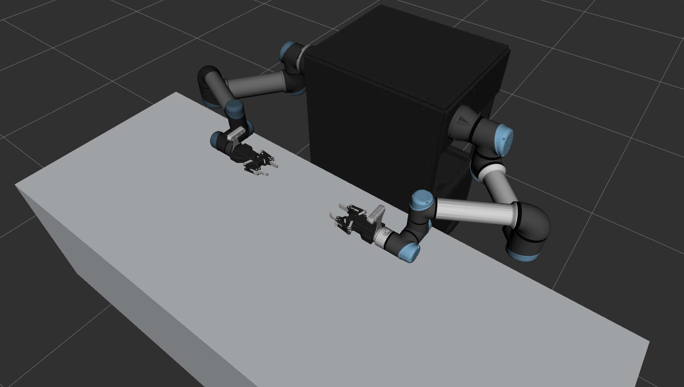
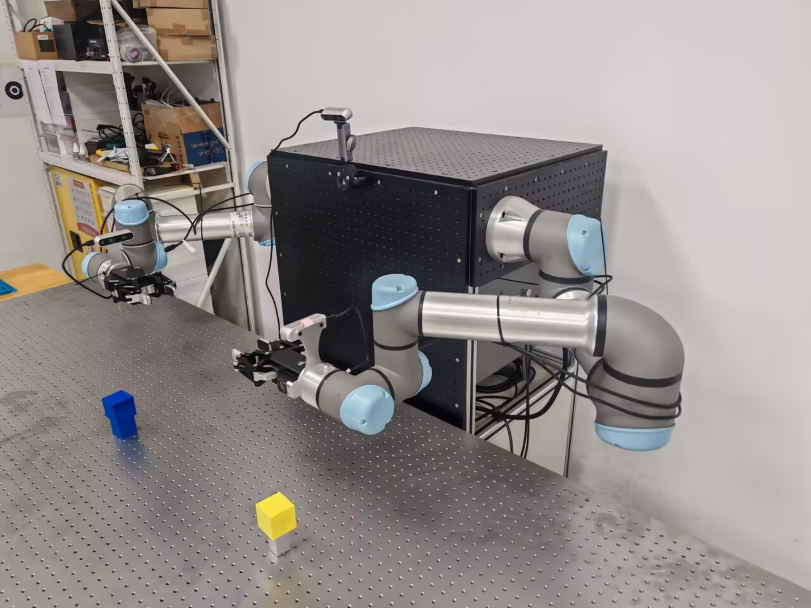
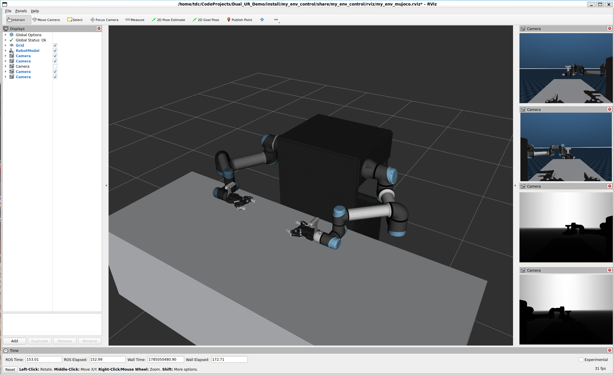
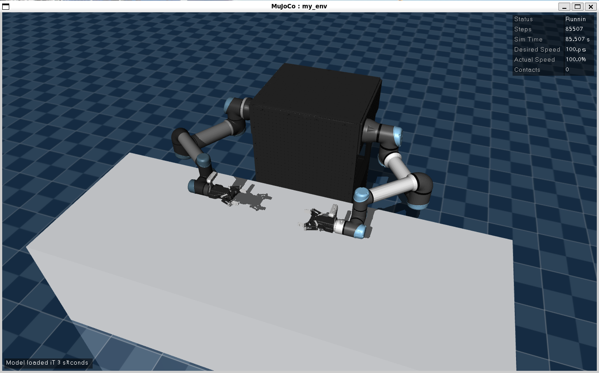

# 双臂UR机械臂ROS2控制系统

> **注意：本项目仅在 ROS2 Jazzy 上进行测试。**

这是一个基于ROS2的双臂UR机械臂控制系统，集成了UR5和UR5e机械臂、Robotiq 2F-85夹爪/DH-AG95夹爪 和RealSense D435相机，目前支持rviz仿真、真实机械臂控制，包含 MoveIt 规划、MoveIt Servo 笛卡尔/关节空间伺服控制。


<table>
  <tr>
    <td ><center>lab_bench_rviz </center></td>
    <td ><center>lab_bench_real </center></td>
  </tr>

  <tr>
    <td><center>lab_bench_mujoco_rviz </center></td>
    <td ><center>lab_bench_mujoco </center> </td>
  </tr>
</table>


## 使用

```bash
git clone https://github.com/TDC-TangChaoBanLi/Dual_UR_Demo.git
cd Dual_UR_Demo
git submodule update --init --recursive

./init_repo.sh    # 初始化：选择环境 / 拉取子模块 / 安装依赖（rosdep + OCS2 deb）
./quick_start.sh  # 编译与启动：编译 / dashboard_client / 启动控制器 / 相机
```

> 各模式（真实机械臂 / RViz 仿真 / MuJoCo 仿真）的手动启动流程、MoveIt 与 MoveIt Servo、
> RealSense 相机、OCS2 安装与使用等详细说明，见 **[.doc/manual_launch.md](.doc/manual_launch.md)**。

## 仓库结构

```
Dual_UR_Demo/
├── init_repo.sh                      # 初始化脚本：选择环境 / 拉取子模块 / 安装依赖
├── quick_start.sh                    # 编译与启动脚本：编译 / dashboard_client / 启动控制器 / 相机
├── src/
│   ├── control/                      # 控制相关代码
│   │   ├── launch_controller/            # 统一启动入口（所有模式的 launch 文件）
│   │   ├── task_control/                 # 任务控制（space_sim 混合作业）
│   │   └── test_control/                 # 测试节点（MoveIt / Servo / MuJoCo 演示）
│   └── envs/                         # 环境（assembly_exp / lab_bench / space_sim）
│       └── <env>/
│           ├── <env>_description/            # 几何描述 + ros2_control 控制器/硬件参数 + RViz 配置
│           ├── <env>_moveit_config/          # MoveIt 配置（SRDF / 规划器 / Servo），lab_bench、space_sim 有
│           └── <env>_mujoco_description/     # MuJoCo 仿真模型（mjcf）与插件配置
├── lib/                              # 外部依赖（git 子模块：robotiq / DH-AG95 夹爪、MuJoCo、serial 等）
└── .doc/                             # 文档与图片（手动启动指南 manual_launch.md）
```

> - 每个环境在 `src/envs/<env>/` 下自包含：描述包 → MoveIt 配置包 →（可选）MuJoCo 仿真包；
> - `lib/` 中的依赖以 git submodule 管理，`init_repo.sh` 可按当前环境选择性拉取；
> - 环境选择保存在 `~/.config/dual_ur_demo/env`，由 `init_repo.sh` 与 `quick_start.sh` 共用。

## 启动选项说明

`./quick_start.sh` 的「启动」流程分两步选择：

### 1. 运行模式（三选一）

| 模式 | 含义 |
|---|---|
| `mock_sim` | 虚拟硬件（`use_fake_hardware:=true`）：命令镜像到状态，无需真机即可验证控制器与话题链路 |
| `mujoco_sim` | MuJoCo 物理仿真（`env:=<env>_mujoco`）：基于 mujoco_ros2_control 的动力学仿真 |
| `real_hardware` | 真实机械臂（`use_fake_hardware:=false`）：需先通过主菜单「启动 dashboard_client」完成初始化；控制器就绪后脚本自动重启 UR 程序（stop → play） |

### 2. 启动项（三选一）

| 启动项 | 含义 | launch 文件 |
|---|---|---|
| `ocs2_arms_control` | **OCS2 双臂 MPC 控制器**：RViz 中拖动 `Left/Right Arm Target` Interactive Marker 设定末端目标，OCS2 在线优化跟踪（FSM：HOME → HOLD → OCS2），另含自适应夹爪控制器与 RViz 面板 | `start_ocs2_arms_controller.launch.py` |
| `joints_controller` | **传统关节控制器**：joint_state_broadcaster + UR 轨迹/位置/速度控制器 + 夹爪控制器（常规轨迹执行；也是 MoveIt Servo 的底层） | `start_joints_controllers.launch.py` |
| `moveit` | **MoveIt 规划**：后台自动启动 `joints_controller`，再拉起 MoveIt `move_group`（配合 RViz 进行运动规划与执行） | `start_moveit_group.launch.py` |

> - 三种启动项均可用 `ros2 launch launch_controller <launch文件>` 手动启动（参数说明见 [.doc/manual_launch.md](.doc/manual_launch.md)）；
> - 选择启动项后会询问是否启动 RViz（回车=启动）。


